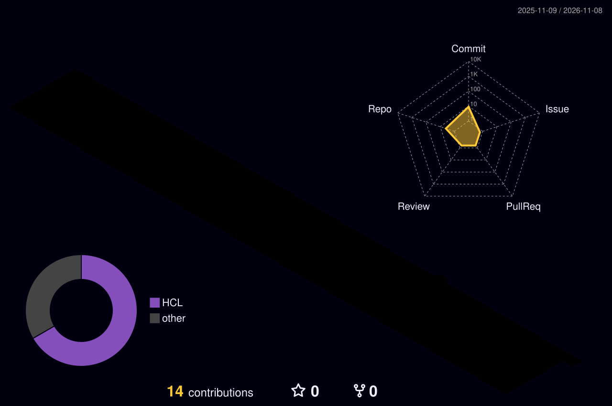

# 🚀 Shubham Arora
### *Cloud Solutions Architect • DevOps &amp; DevSecOps Engineer • Enterprise Terraform Specialist*

 

---

### 🌐 3D ISOMETRIC GITHUB CONTRIBUTIONS

  

---

## 🏆 Featured Flagship Project

### ⚡ [terraform-azure-labs](https://github.com/shubhamarora4000-cloud/terraform-azure-labs)
**Enterprise Multi-Region Azure Landing Zone with Zero-Trust Security, Hub &amp; Spoke Networking, DR &amp; Compliance**

  🔥 <b>Architectural Highlights:</b>
  <ul>
    <li><b>Hub-and-Spoke Networking:</b> Azure Firewall (IDPS), Azure Bastion, NSGs, UDR 0.0.0.0/0 route tunneling, Private DNS.</li>
    <li><b>Zero-Trust Security:</b> Azure Key Vault (RBAC + Purge Protection), CMK 4096-bit disk encryption, Defender for Cloud, Microsoft Sentinel.</li>
    <li><b>Disaster Recovery (BCDR):</b> Multi-region failover (East US &lt;-&gt; Central US), ASR 15m RPO replication, RA-GRS Storage, Traffic Manager.</li>
    <li><b>Continuous Observability:</b> Central Log Analytics (90d retention), App Insights, CloudOps Action Groups, Metric Alerts.</li>
    <li><b>Policy Enforcement:</b> CIS Azure Foundations v2.0 benchmark enforcement, automated deny public IPs, mandatory tagging.</li>
    <li><b>FinOps &amp; Governance:</b> Management Groups hierarchy, Resource Locks, and tiered budget alerts.</li>
    <li><b>Backup:</b> Recovery Services Vault with GFS retention (Daily, Weekly, Monthly, 5-Year Archive).</li>
  </ul>

---

## 🛠️ Enterprise Tech Stack

| Domain | Technologies &amp; Tools |
| :--- | :--- |
| **Cloud Providers** |   |
| **Infrastructure as Code** |    |
| **Containers & Orchestration** |    |
| **CI/CD & DevSecOps** |    |
| **Security & SIEM** |   |
| **Scripting & Automation** |    |

---

## 📊 Live GitHub Analytics

  
  

  

---

  ⭐️ Star my repositories if you find them helpful! • Designed for Cloud Excellence

